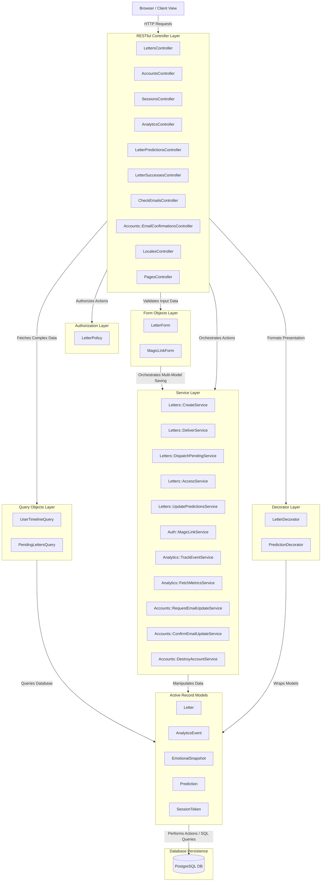
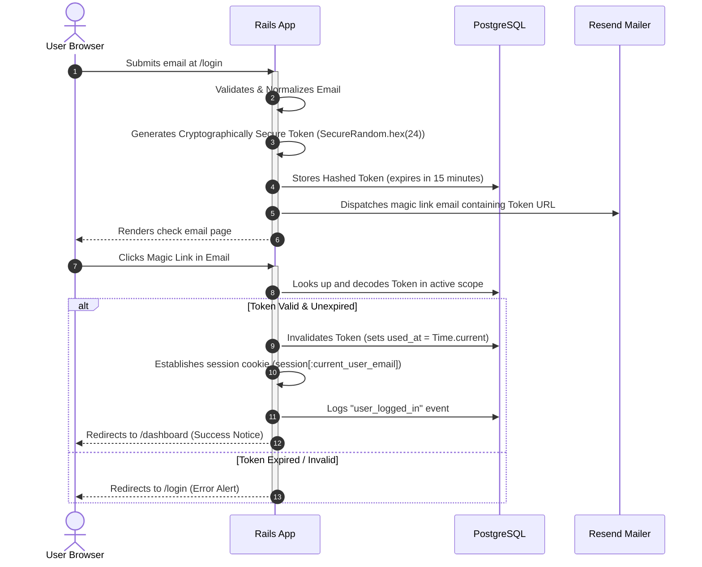
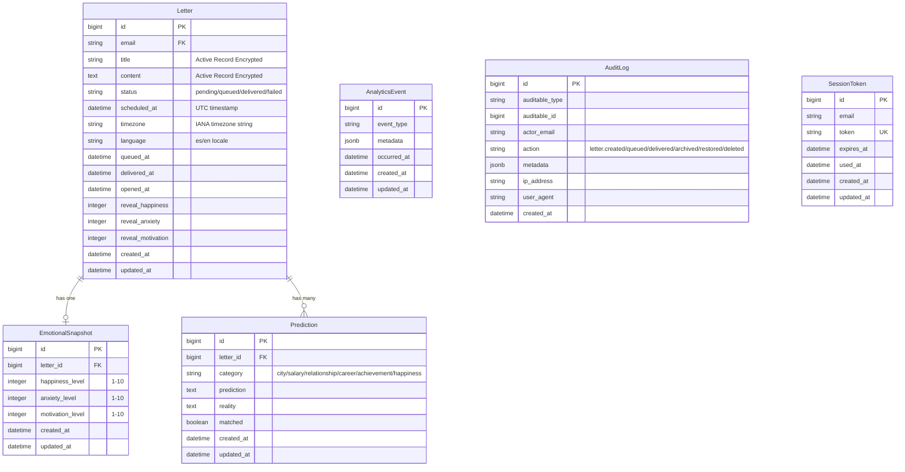
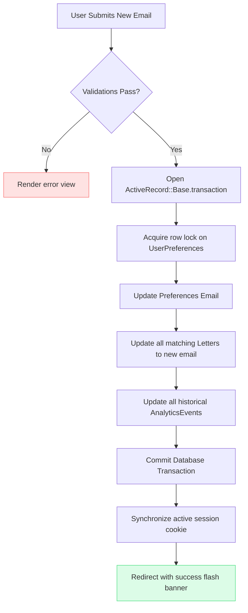
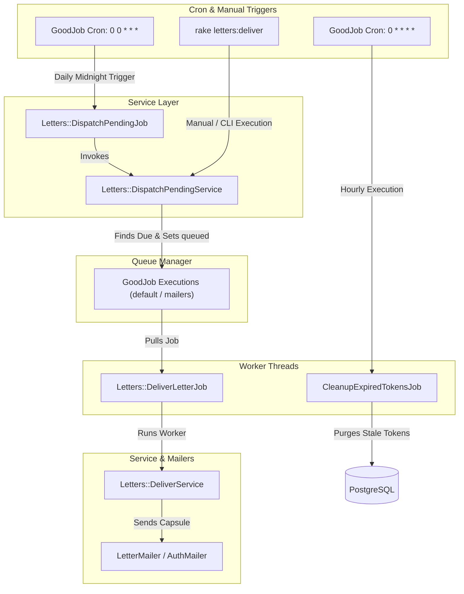

# ⏳ TimeEcho — System Architecture & Design

Welcome to the architectural overview of **TimeEcho**, a premium future-letter digital capsule platform built with **Ruby on Rails 8** and **Tailwind CSS v4 / DaisyUI v5**.

This document details the layered architectural patterns, data relationships, transactional boundaries, background job execution lifecycles, and the secure authentication flow powering the TimeEcho ecosystem.

---

## 🏛️ 1. Layered Architecture & Architectural Patterns

TimeEcho adopts a highly decoupled, layered architecture built on top of the traditional Model-View-Controller (MVC) paradigm. By isolating business logic, query parameters, presentation formats, authorization checks, and form validations into dedicated layers, the codebase remains clean, testable, and highly maintainable.



### Key Structural Layers:

1. **Model-View-Controller (MVC) & RESTful Controller Design**:
   - **Controllers**: Extremely thin layers strictly focused on the seven standard RESTful actions (`index`, `show`, `new`, `create`, `update`, `destroy`). Any custom collection or member flows are extracted into dedicated, single-responsibility controllers (e.g., `LocalesController` for session-persisted locale selection, `LetterPredictionsController` to update reality states, `Accounts::EmailConfirmationsController` to process confirmation links, `PagesController` for landing and static info pages).
   - **Views**: Rendered in English/Spanish (using Rails i18n localization). Powered by Tailwind CSS v4 and DaisyUI v5, using semantic component layout rules.
   - **Models**: Encapsulate basic relationships, validations, and scopes. Heavy business actions are offloaded to Services.

2. **Decorator / Presenter Layer (`app/decorators/`)**:
   - Completely decouples visual presentation logic, custom date formatting, dynamic icons, status pills, and localized conditional class tags from views and database models.
   - **`LetterDecorator`**: Handles letters relative date strings, delivery states, countdown days left metrics, and localized title resolution.
   - **`PredictionDecorator`**: Manages prediction category labels, achievement victory badges, and status colors.

3. **Form Objects Layer (`app/forms/`)**:
   - Encapsulate form validation and multi-model record synchronization.
   - **`LetterForm`**: Collects and validates inputs for `Letter`, `EmotionalSnapshot`, and several potential `Prediction` fields in a single schema. It executes the creation inside a single ActiveRecord database transaction with IANA timezone conversion.
   - **`MagicLinkForm`**: Validates the email submitted during login.

4. **Service Objects Layer (`app/services/`)**:
   - Encapsulate single-responsibility business operations across domain namespaces:
   - **`Letters::CreateService`**: Receives params, validates them via `LetterForm`, and persists the future capsule.
   - **`Letters::DeliverService`**: Transitions capsule status (`pending` -> `queued` -> `delivered`/`failed`), sends the email via `LetterMailer`, tracks success/failure analytics, and rolls back if errors arise.
   - **`Letters::DispatchPendingService`**: Finds due pending capsules and enqueues deliver jobs into GoodJob.
   - **`Letters::AccessService`**: Handles authorization access logic for private letter retrieval.
   - **`Letters::UpdatePredictionsService`**: Updates reality reflections and match states for delivered predictions.
   - **`Auth::MagicLinkService`**: Generates, signs, sends, and authenticates cryptographically secure passwordless tokens.
   - **`Analytics::TrackEventService`**: Logs granular user actions to `analytics_events` for retrospection.
   - **`Analytics::FetchMetricsService`**: Aggregates retrospective dashboard metrics (capsule counts, emotional baselines, prediction match ratios).
   - **`Accounts::RequestEmailUpdateService`**: Dispatches email address update confirmation magic links.
   - **`Accounts::ConfirmEmailUpdateService`**: Atomically updates user email address across preferences, letters, and events.
   - **`Settings::UpdatePreferencesService`**: Updates user appearance mode, theme, reflection style, and notification preferences.
   - **`Accounts::DestroyAccountService`**: Atomically purges all user records ("Danger Zone" account deletion).

5. **Query Objects Layer (`app/queries/`)**:
   - Isolate complex ActiveRecord operations from controllers and models to maintain clean separation of concerns.
   - **`UserTimelineQuery`**: Loads all capsules owned by a user, utilizing eager-loading (`includes(:predictions, :emotional_snapshot)`) to avoid $N+1$ query issues.
   - **`PendingLettersQuery`**: Finds letters ready for release, employing high-concurrency database row locking (`FOR UPDATE SKIP LOCKED`).

6. **Policy Layer (`app/policies/`)**:
   - Decouples authorization rules.
   - **`LetterPolicy`**: Implements fine-grained access control rules:
     - Letters are strictly private digital capsules locked to their creator (`user_email.present? && letter.email == user_email`).

---

## 🔑 2. Passwordless Magic Link Authentication Lifecycle

TimeEcho implements a secure, passwordless authentication workflow utilizing single-use, time-sensitive cryptographic access tokens generated on the fly.



---

## 📊 3. Database Schema & Domain Relations

Below is the entity-relationship design showing the relational mapping, attributes, and ownership structures within a user's vault.



> [!SECURITY]
> **Active Record Encryption**: Letter titles (`encrypts :title`) and letter body content (`encrypts :content`) are encrypted at rest using Rails Active Record Encryption. Keys are configured via environment variables (`ACTIVE_RECORD_ENCRYPTION_PRIMARY_KEY`, `ACTIVE_RECORD_ENCRYPTION_DETERMINISTIC_KEY`, `ACTIVE_RECORD_ENCRYPTION_KEY_DERIVATION_SALT`).

---

## 🔄 4. Atomic Transactional Email Migrations & Data Wipeouts

To guarantee absolute transactional integrity and prevent orphaned rows or security breaches, TimeEcho handles sensitive account updates in strict atomic blocks.

### Email Update Transaction

When a user updates their email inside `AccountsController#update`, all associated entities must migrate in tandem to prevent locking out the user from their historical capsules.



### Complete Account Deletion ("Danger Zone" Wipeout)

If a user triggers "Eliminar mi baúl" in their settings, a direct PostgreSQL transactional block (`Accounts::DestroyAccountService`) triggers. This wipes out:

1. All foreign keys (`predictions`, `emotional_snapshots`) matching the user's `Letter` IDs.
2. The `Letter` records themselves.
3. Historical `AnalyticsEvent` records matching the user's email inside metadata.
4. All active session contexts are immediately cleared.

---

## ⚙️ 5. Background Job Processing (GoodJob)

Rails 8 uses **GoodJob** as the database-backed Active Job queue adapter. TimeEcho is configured to leverage GoodJob for all asynchronous services in both development and production.



### Background System Components:

1. **Daily Automated Dispatch Job (`Letters::DispatchPendingJob`)**:
   - Runs **daily at midnight (`0 0 * * *`)** via GoodJob cron. Triggers `Letters::DispatchPendingService` to query due pending capsules (`scheduled_at <= Time.current`), update status to `"queued"`, and enqueue `Letters::DeliverLetterJob` worker jobs into GoodJob.
2. **Manual/CLI Rake Task (`rake letters:deliver`)**:
   - Provides a standalone CLI entry point that invokes `Letters::DispatchPendingService` directly, useful for on-demand execution or external scheduler triggers.
3. **Resilient Delivery Worker (`Letters::DeliverLetterJob`)**:
   - Processes individual letter deliveries via `Letters::DeliverService`. Configured with `retry_on` using polynomial backoff to handle transient network timeouts or third-party email API hiccups without data loss, updating status to `delivered` or `failed`.
4. **Hourly Cron (`CleanupExpiredTokensJob`)**:
   - Runs **every hour (`0 * * * *`)** via GoodJob cron to clean up expired magic-link sessions and spent tokens.
5. **High-Concurrency Locking (`SKIP LOCKED`)**:
   - In `PendingLettersQuery`, letters due for unlock are queried with `.lock("FOR UPDATE SKIP LOCKED")`. This allows concurrent workers to process without duplicate mailing attempts or deadlocking the letters table.

---

## 🎨 6. Premium Theme System & Styling Tokens

TimeEcho operates on a tailored design system powered by Tailwind CSS v4 and DaisyUI v5. The application achieves its **Calm, Nostalgic, Secure** aesthetic through strict, consistent visual variables.

### Semantic Design Tokens:

- **Typography Hierarchy**:
  - _UI & Body Copy_: Use the geometric **Inter** sans-serif stack exclusively across all views, headers, forms, settings cards, and letter representations. Typographic consistency is crucial to maintaining our high-integrity digital vault aesthetics.
- **Palette Design Rules**:
  - Uses tailored HSL and OkLCH-supported color configurations (avoiding raw hex values) to maintain high contrast standards.
  - Uses a dedicated postal and archival palette with light (`timeecho`) and dark (`timeecho-dark`) modes, ensuring visual coherence across all devices.
- **Consistent Shapes**:
  - Standardized white content container cards must always use `rounded-3xl` border-radius shapes, thin border boundaries (`border-slate-100`), and clean micro-shadows (`shadow-2xs`) across all views.

---

## 🌐 7. Internationalization (i18n) Architecture

TimeEcho implements a lightweight, two-locale internationalization system using Rails' built-in `I18n` framework. The architecture prioritizes explicit locale control, graceful fallbacks, and clean separation between view templates and translated strings.

### 7.1 Locale Configuration

The application's locale settings are configured in `config/application.rb`:

```ruby
config.i18n.available_locales = [ :es, :en ]
config.i18n.default_locale = :en
```

- **Allowed locales**: Only `:es` (Spanish) and `:en` (English) are permitted. Any other locale requested by the browser is rejected and falls back to the default.
- **Default locale**: `:en` (English) serves as both the default UI language and the ultimate fallback for unsupported locales or missing translations.
- **Fallbacks**: Enabled in `config/environments/production.rb` and `config/environments/test.rb` via `config.i18n.fallbacks = true`. When `fallbacks = true`, any missing key in a locale falls back to the `default_locale` rather than rendering the raw key name.

### 7.2 Locale Resolution & Session Toggling (`set_locale`)

Locale resolution is handled by the `set_locale` before_action in `ApplicationController`. It supports both explicit user selection (persisted across sessions via `LocalesController`) and automatic browser header detection:

```mermaid
flowchart TD
    A[Request received] --> B{session[:locale] present & valid?}
    B -- Yes --> C[Set I18n.locale to session locale]
    B -- No --> D{HTTP_ACCEPT_LANGUAGE present?}
    D -- No --> E[Locale unchanged, uses default]
    D -- Yes --> F[Extract 2-letter browser locale]
    F --> G{Locale in [:es, :en]?}
    G -- Yes --> H[Set I18n.locale to browser locale]
    G -- No --> E
```

| Source | Input Value | Supported? | Resulting Locale |
| ------ | ----------- | ---------- | ---------------- |
| Session | `session[:locale] = "es"` | Yes | `:es` |
| Session | `session[:locale] = "en"` | Yes | `:en` |
| Browser Header | `HTTP_ACCEPT_LANGUAGE: "es-ES,es;q=0.9"` | Yes | `:es` |
| Browser Header | `HTTP_ACCEPT_LANGUAGE: "en-US,en;q=0.9"` | Yes | `:en` |
| Browser Header | `HTTP_ACCEPT_LANGUAGE: "fr-FR,fr;q=0.9"` | No | `:en` (default, unchanged) |
| None | (no session, no header) | No | `:en` (default, unchanged) |

### 7.3 LocalesController & Navigation Toggle

Users can switch languages on the fly from the navigation bar. The toggle button uses the `toggle_locale` helper to submit to `LocalesController`:

- `POST /locales?locale=es` / `POST /locales?locale=en`: Writes `params[:locale]` to `session[:locale]` and redirects back to the previous page.
- `DELETE /locales/:id`: Clears `session[:locale]` to return to browser auto-detection.

### 7.4 Test Locale Strategy

The test suite establishes `I18n.locale = :es` globally in `test/test_helper.rb` via a `setup` block on `ActiveSupport::TestCase`. Because test requests do not send an `Accept-Language` header or a preset session locale by default, the `set_locale` before_action does not override this pre-set Spanish locale, ensuring all assertions match Spanish text expectations.

```ruby
# test/test_helper.rb
class TestCase
  setup { I18n.locale = :es }
end
```

The `ApplicationControllerTest` and `LocalesControllerTest` cover session persistence, language toggling, and fallback behavior across supported (`es`, `en`) and unsupported (`fr`) headers.

### 7.5 Decorator Integration & Title Localization

All locale-dependent formatting (dates, status badges, category labels, countdown strings) is encapsulated in decorators within `app/decorators/`:

- **LetterDecorator**: `display_title` (translates default `"your_letter"` / localized title placeholders dynamically based on `I18n.locale`), `formatted_created_at`, `formatted_delivered_at`, `days_left_text`, `status_badge`.
- **PredictionDecorator**: `category_label`, `result_badge`.

### 7.6 View Text Policy

All user-facing strings in ERB views must use `t()` calls — no hardcoded Spanish or English text is permitted. HTML comments in views should be in English for consistency.

---

## 🚀 8. Production Deployment Architectures

TimeEcho supports modern production deployment workflows designed for reliability and low resource overhead:

### 8.1 Kamal Container Deployment (IaaS / Bare Metal)

Turnkey container deployment configured in `config/deploy.yml`:

- Leverages the multi-stage Docker build (`Dockerfile`) to create a minimal, hardened production image.
- Supports rolling zero-downtime updates, asset volume management, and direct integration with managed PostgreSQL and Resend transactional email.

---

## 📡 9. REST API Architecture (v1)

TimeEcho exposes a standardized RESTful JSON API under `/api/v1` primarily consumed by the mobile client (Expo / React Native). The API is built to guarantee an immutable response contract, strict separation of concerns, and centralized error handling from HTTP status 200 through 503.

### 9.1 Single-Responsibility Pipeline

Every API interaction adheres to a strict pipeline where each component has exactly one responsibility:

| Component | Input | Output / Behavior | Restriction |
|---|---|---|---|
| **Service** (`app/services/`) | Raw parameters / domain models | `Result` object (`success?`, `letter`/`value`, `error`, `errors`, `message`) | Agnostic of HTTP transport and controllers |
| **`ResultHandler#unwrap!`** (`app/controllers/concerns/api/result_handler.rb`) | `Result` | Unwrapped domain entity or raises domain exception | **Never renders** JSON or HTTP responses |
| **Controller** (`app/controllers/api/v1/`) | Incoming HTTP request | Sets `@variables`, calls `unwrap!`, chooses 2xx status (`:created`, `render_no_content`) | Never catches errors, never renders raw error JSON, never assigns 4xx/5xx |
| **`ErrorHandler`** (`app/controllers/concerns/api/error_handler.rb`) | Rescued controller exception | Renders `api/v1/shared/error.json.jbuilder` with HTTP status | Evaluated bottom-to-top by Rails (`StandardError` first) |
| **`exceptions_app`** (`Api::V1::ExceptionsController#show`) | Unhandled router/middleware exception | Renders standardized JSON error payload | Handles 404/500/etc. occurring outside controller action dispatch |
| **Jbuilder Views** (`app/views/api/v1/`) | `@variables` (assigned in controller) | Serializes data into camelCase JSON envelope | Formats output via deep formatting |

### 9.2 API Base Controller Composition

All API controllers inherit from `Api::V1::BaseController < ActionController::API`, which includes:
- `Api::ApiResponse`: Provides `paginate(scope)` (Pagy, clamped between 1 and 100, default 20) and `render_no_content` (`head :no_content`).
- `Api::ResultHandler`: Provides `unwrap!(result)` backed by `RESULT_ERRORS`.
- `Api::ErrorHandler`: Provides centralized `rescue_from` handlers for all domain and framework exceptions.

### 9.3 Unified Response Contract

All endpoints adhere to one of three JSON envelopes with keys camelized in `camelCase` (`Jbuilder.key_format camelize: :lower` + `Jbuilder.deep_format_keys true`):

#### 1. Single Resource Success (200 / 201)
```json
{
  "data": {
    "id": "1",
    "docketNumber": "TE-00001",
    "title": "Future Self Letter",
    "scheduledAt": "2027-10-26T20:00:00Z",
    "emotionalSnapshot": {
      "happinessLevel": 8
    },
    "predictions": []
  },
  "meta": {}
}
```

#### 2. Collection Success (200)
```json
{
  "data": [
    { "id": "1", "title": "First Letter" },
    { "id": "2", "title": "Second Letter" }
  ],
  "meta": {
    "page": 1,
    "perPage": 20,
    "total": 42,
    "totalPages": 3
  }
}
```

#### 3. Error Response (4xx / 5xx)
```json
{
  "error": {
    "code": "validation_failed",
    "message": "Title can't be blank",
    "details": {
      "title": ["can't be blank"]
    },
    "requestId": "9c1b3f6e-..."
  }
}
```
*Note: `details` is only rendered if populated. In production, 500 errors never expose internal exception messages or backtraces.*

### 9.4 Complete HTTP Status & Error Mapping

| Status | Origin | `error.code` | Handling Behavior |
|---|---|---|---|
| **200 OK** | `GET`, `PATCH`, `PUT` | — | Renders Jbuilder template |
| **201 Created** | `POST` | — | `render :show, status: :created` |
| **204 No Content** | `DELETE` | — | `render_no_content` |
| **400 Bad Request** | `ActionController::ParameterMissing`, `ActionDispatch::Http::Parameters::ParseError` | `"bad_request"` | Parameter or malformed JSON syntax error |
| **401 Unauthorized** | `Api::UnauthorizedError`, `authenticate_user!`, `RESULT_ERRORS[:unauthorized]` | `"unauthorized"` | Missing, invalid, or expired session token, or unauthenticated action |
| **403 Forbidden** | `Api::ForbiddenError`, `RESULT_ERRORS[:forbidden]` | `"forbidden"` | Forbidden action or administrative access denial |
| **404 Not Found** | `ActiveRecord::RecordNotFound`, `Api::NotFoundError`, Catch-all route | `"not_found"` | Missing record, resource not owned by user, or unmatched API route |
| **406 Not Acceptable** | `ActionController::UnknownFormat` | `"not_acceptable"` | Requested mime-type cannot be served |
| **409 Conflict** | `ActiveRecord::RecordNotUnique`, `ActiveRecord::StaleObjectError` | `"conflict"` | Uniqueness violation or optimistic locking collision |
| **422 Unprocessable** | `ActiveRecord::RecordInvalid`, `Api::BusinessRuleError` | `"validation_failed"` / specific code | Validation failure or business rule violation (`cannot_delete`, `cannot_restore`, `cannot_archive_delivered`) |
| **429 Too Many Requests** | `Api::RateLimitedError`, `Rack::Attack` | `"rate_limited"` | Throttled response with `Retry-After` header |
| **500 Internal Error** | `StandardError` | `"internal_error"` | Logged with `requestId` + backtrace, captured in Sentry; masked in production |
| **503 Service Unavailable** | `Api::ServiceUnavailableError` | `"service_unavailable"` | Upstream failure, timeout, or external dependency disruption |

### 9.5 Implemented v1 Endpoints & Resources

| Method | Endpoint | Controller Action | Success Status | Unwrapped Service / Operation |
|---|---|---|---|---|
| `GET` | `/livez`, `/api/v1/health/liveness` | `Api::V1::HealthController#liveness` | `200 OK` | Lightweight process liveness probe |
| `GET` | `/readyz`, `/api/v1/health` | `Api::V1::HealthController#show` | `200 OK` | `Health::CheckService.call` (DB, migrations, GoodJob queue) |
| `GET` | `/api/v1/ping` | Rack proc | `200 OK` | Timestamp & status diagnostic |
| `GET` | `/api-docs` | `Rswag::Ui::Engine` | `200 OK` | Interactive Swagger UI API documentation |
| `GET` | `/api-docs/v1/swagger.yaml` | `Rswag::Api::Engine` | `200 OK` | OpenAPI 3.0.3 specification document |
| `GET` | `/api/v1/letters` | `Api::V1::LettersController#index` | `200 OK` | Paginated scope via `UserTimelineQuery` |
| `POST` | `/api/v1/letters` | `Api::V1::LettersController#create` | `201 Created` | `Letters::CreateService.call(...)` |
| `GET` | `/api/v1/letters/:id` | `Api::V1::LettersController#show` | `200 OK` | `Letters::AccessService.call(...)` |
| `PATCH/PUT` | `/api/v1/letters/:id` | `Api::V1::LettersController#update` | `200 OK` | `Letters::UpdateService.call(...)` |
| `DELETE` | `/api/v1/letters/:id` | `Api::V1::LettersController#destroy` | `204 No Content` | `Letters::DeleteService.call(...)` |
| `POST` | `/api/v1/letters/:letter_id/predictions` | `Api::V1::LetterPredictionsController#create` | `201 Created` | Letter lookup + nested prediction creation |
| `POST` | `/api/v1/letters/:id/archive` | `Api::V1::Letters::ArchivesController#create` | `200 OK` | `Letters::ArchiveService.call(...)` |
| `POST` | `/api/v1/letters/:id/restore` | `Api::V1::Letters::RestoresController#create` | `200 OK` | `Letters::RestoreService.call(...)` |
| `POST` | `/api/v1/sessions` | `Api::V1::SessionsController#create` | `201 Created` | `Auth::RequestMagicLinkService.call(...)` (revokes active session tokens & issues fresh magic link) |
| `GET` | `/api/v1/sessions/:token` | `Api::V1::SessionsController#show` | `200 OK` | `Auth::AuthenticateTokenService.call(...)` |
| `GET` | `/api/v1/sessions/me` | `Api::V1::SessionsController#me` | `200 OK` | Current authenticated user profile |
| `DELETE` | `/api/v1/sessions` | `Api::V1::SessionsController#destroy` | `204 No Content` | `Auth::DestroySessionService.call(...)` |
| `*` | `/api/v1/*path` | `Api::V1::BaseController#route_not_found` | `404 Not Found` | Catch-all for undefined `/api/v1` routes |

### 9.6 OpenAPI & Health Probes Architecture

- **Liveness Probe (`/livez` & `/api/v1/health/liveness`)**:
  - Validates process responsiveness with zero external dependencies.
  - Returns `200 OK` with `{ "data": { "status": "alive", "timestamp": "..." }, "meta": {} }`.
- **Readiness / Healthcheck Probe (`/readyz` & `/api/v1/health`)**:
  - Validates PostgreSQL database connectivity (`SELECT 1`), verifies that no migrations are pending (`ActiveRecord::Migration.check_all_pending!`), and checks background worker table availability (`GoodJob::Job.table_exists?`).
  - Returns `200 OK` with latency diagnostics when healthy.
  - Returns `503 Service Unavailable` with structured diagnostic error details if any critical dependency fails.
- **Swagger Documentation Engine (`/api-docs`)**:
  - Serves Swagger UI powered by `rswag-ui` and `rswag-api`.
  - Comprehensive OpenAPI 3.0.3 specification maintained at `swagger/v1/swagger.yaml`.


