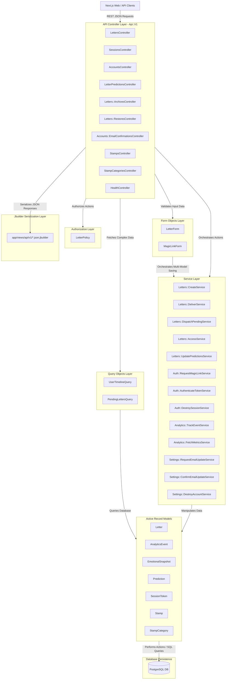
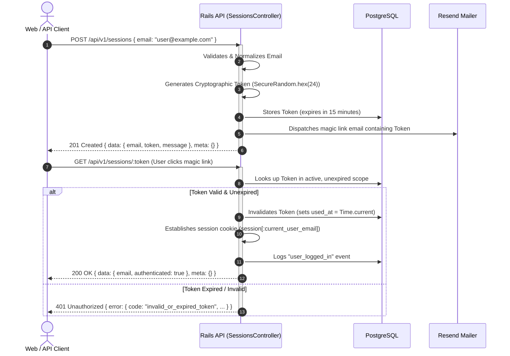
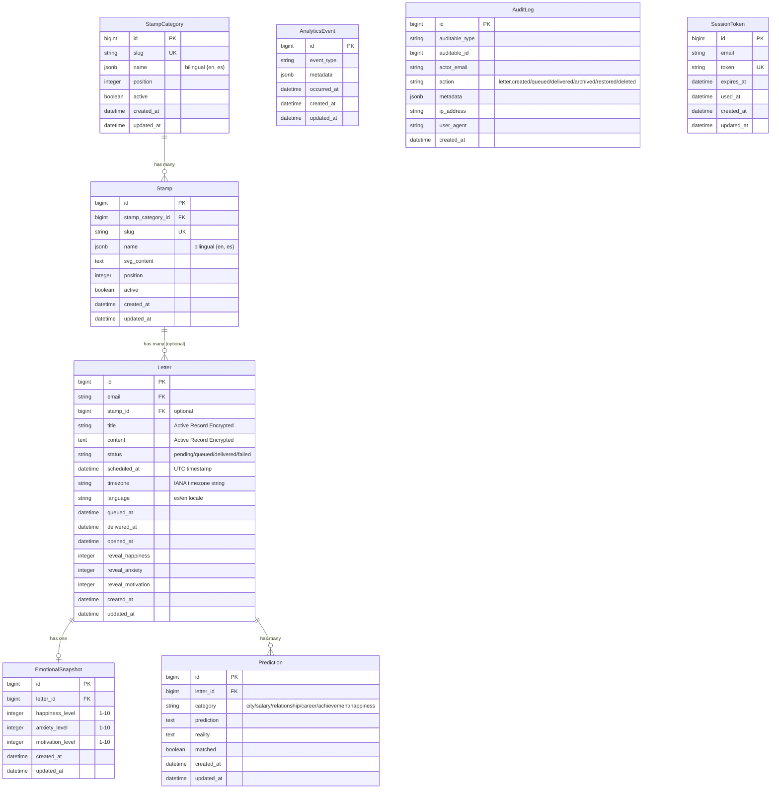
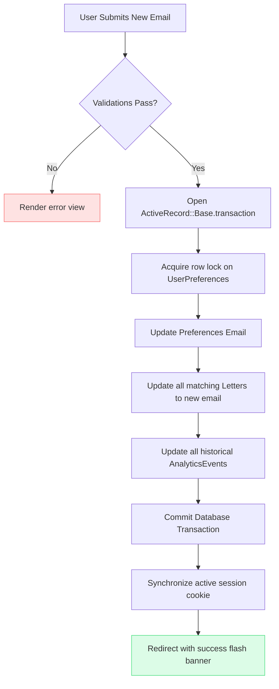
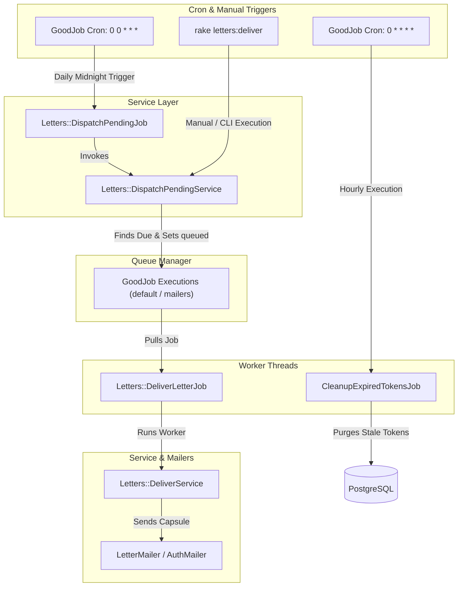

# ⏳ TimeEcho — Backend Architecture & System Design

Welcome to the architectural overview of the **TimeEcho Backend**, a high-integrity, API-only future-letter digital capsule platform built with **Ruby on Rails 8** (`config.api_only = true`), **PostgreSQL**, **Active Record Encryption**, and **GoodJob**.

This document details the layered architectural patterns, data relationships, transactional boundaries, background job execution lifecycles, and the secure authentication flow powering the TimeEcho ecosystem.

---

## 🏛️ 1. Layered Architecture & Architectural Patterns

TimeEcho adopts a decoupled, layered API architecture. By isolating business logic, query parameters, presentation serialization, authorization checks, and form validations into dedicated layers, the backend remains clean, testable, and highly maintainable.



### Key Structural Layers:

1. **RESTful API Controllers (`app/controllers/api/v1/`)**:
   - Inherit from `Api::V1::BaseController < ActionController::API`.
   - Focused strictly on standard RESTful actions (`index`, `show`, `create`, `update`, `destroy`).
   - Delegates business execution to domain services via `ResultHandler#unwrap!`.
   - Centralized exception mapping and standard JSON envelopes via `ErrorHandler`.

2. **Jbuilder JSON Serialization Layer (`app/views/api/v1/`)**:
   - Serializes domain records into strictly formatted JSON envelopes with lowerCamelCase keys (`Jbuilder.key_format camelize: :lower`).
   - Standardized `data`, `meta`, and `error` payloads.

3. **Form Objects Layer (`app/forms/`)**:
   - Encapsulate form validation and multi-model record synchronization.
   - **`LetterForm`**: Collects and validates inputs for `Letter`, `EmotionalSnapshot`, optional digital `Stamp` (via `stamp_slug` or `stamp_id`), and nested `Prediction` records in a single transactional schema.
   - **`MagicLinkForm`**: Validates the email address submitted during passwordless sign-in.

4. **Service Objects Layer (`app/services/`)**:
   - Encapsulate single-responsibility business operations across domain namespaces:
   - **`Letters::CreateService`**: Validates parameters via `LetterForm` and persists the future capsule.
   - **`Letters::DeliverService`**: Transitions capsule status (`pending` -> `queued` -> `delivered`/`failed`), sends the email via `LetterMailer`, tracks analytics, and logs audit events.
   - **`Letters::DispatchPendingService`**: Finds due pending capsules and enqueues deliver jobs into GoodJob.
   - **`Letters::AccessService`**: Handles authorization and access logging for private letter retrieval.
   - **`Letters::UpdatePredictionsService`**: Updates reality reflections and match states for delivered predictions.
   - **`Auth::RequestMagicLinkService`**: Generates and emails cryptographic sign-in tokens.
   - **`Auth::AuthenticateTokenService`**: Validates tokens, sets session state, and marks tokens used.
   - **`Auth::DestroySessionService`**: Revokes active session tokens and clears session state.
   - **`Analytics::TrackEventService`**: Logs user actions to `analytics_events`.
   - **`Analytics::FetchMetricsService`**: Aggregates retrospective metrics (capsule counts, emotional baselines, prediction accuracy).
   - **`Settings::RequestEmailUpdateService`**: Dispatches email update confirmation magic links.
   - **`Settings::ConfirmEmailUpdateService`**: Atomically updates user email address across preferences, letters, and events.
   - **`Settings::DestroyAccountService`**: Atomically purges all user records.

5. **Query Objects Layer (`app/queries/`)**:
   - Isolate complex ActiveRecord operations from controllers and models.
   - **`UserTimelineQuery`**: Loads all capsules owned by a user, utilizing eager-loading (`includes(:predictions, :emotional_snapshot, :stamp)`) to eliminate $N+1$ queries.
   - **`PendingLettersQuery`**: Finds letters ready for release, employing high-concurrency database row locking (`FOR UPDATE SKIP LOCKED`).

6. **Policy Layer (`app/policies/`)**:
   - Decouples authorization rules.
   - **`LetterPolicy`**: Implements fine-grained access control rules:
     - Letters are strictly private digital capsules locked to their creator (`user_email.present? && letter.email == user_email`).

---

## 🔑 2. Passwordless Magic Link Authentication Lifecycle

TimeEcho implements a secure, passwordless authentication workflow utilizing single-use, time-sensitive cryptographic access tokens generated on the fly.



---

## 📊 3. Database Schema & Domain Relations

Below is the entity-relationship design showing the relational mapping, attributes, and ownership structures within a user's vault.



> [!SECURITY]
> **Active Record Encryption**: Letter titles (`encrypts :title`) and letter body content (`encrypts :content`) are encrypted at rest using Rails Active Record Encryption. Keys are configured via environment variables (`ACTIVE_RECORD_ENCRYPTION_PRIMARY_KEY`, `ACTIVE_RECORD_ENCRYPTION_DETERMINISTIC_KEY`, `ACTIVE_RECORD_ENCRYPTION_KEY_DERIVATION_SALT`).

---

## 🔄 4. Atomic Transactional Email Migrations & Data Wipeouts

To guarantee absolute transactional integrity and prevent orphaned rows or security breaches, TimeEcho handles sensitive account updates in strict atomic blocks.

### Email Update Transaction

When a user updates their email inside `SettingsController#update`, all associated entities must migrate in tandem to prevent locking out the user from their historical capsules.



### Complete Account Deletion ("Danger Zone" Wipeout)

If a user triggers "Eliminar mi baúl" in their settings, a direct PostgreSQL transactional block (`Settings::DestroyAccountService`) triggers. This wipes out:

1. All foreign keys (`predictions`, `emotional_snapshots`) matching the user's `Letter` IDs.
2. The `Letter` records themselves.
3. Historical `AnalyticsEvent` records matching the user's email inside metadata.
4. All active session contexts are immediately cleared.

---

## ⚙️ 5. Background Job Processing (GoodJob)

Rails 8 uses **GoodJob** as the database-backed Active Job queue adapter. TimeEcho is configured to leverage GoodJob for all asynchronous services in both development and production.



### Background System Components:

1. **Daily Automated Dispatch Job (`Letters::DispatchPendingJob`)**:
   - Runs **daily at midnight (`0 0 * * *`)** via GoodJob cron. Triggers `Letters::DispatchPendingService` to query due pending capsules (`scheduled_at <= Time.current`), update status to `"queued"`, and enqueue `Letters::DeliverLetterJob` worker jobs into GoodJob.
2. **Manual/CLI Rake Task (`rake letters:deliver`)**:
   - Provides a standalone CLI entry point that invokes `Letters::DispatchPendingService` directly, useful for on-demand execution or external scheduler triggers.
3. **Resilient Delivery Worker (`Letters::DeliverLetterJob`)**:
   - Processes individual letter deliveries via `Letters::DeliverService`. Configured with `retry_on` using polynomial backoff to handle transient network timeouts or third-party email API hiccups without data loss, updating status to `delivered` or `failed`.
4. **Hourly Cron (`CleanupExpiredTokensJob`)**:
   - Runs **every hour (`0 * * * *`)** via GoodJob cron to clean up expired magic-link sessions and spent tokens.
5. **High-Concurrency Locking (`SKIP LOCKED`)**:
   - In `PendingLettersQuery`, letters due for unlock are queried with `.lock("FOR UPDATE SKIP LOCKED")`. This allows concurrent workers to process without duplicate mailing attempts or deadlocking the letters table.

---

## 🎨 6. Client Decoupling & Epistolary Metaphor

TimeEcho's user interface is fully decoupled from the Rails API backend. The web application is built with **Next.js 16**, **React 19**, and **Tailwind CSS v4** (located in `frontend/`), and its component design system is maintained in isolation via **Storybook 10** (`mockups/`).

The backend's role in the design system is strictly informational and contract-based:
- Serving dynamic stamp assets (`svg_content`, `slug`, `name`, `category`) via `/api/v1/stamps`.
- Persisting letters with docket identifiers (`TE-XXXXX`), status progressions (`pending`, `queued`, `delivered`), and retrospective evaluation data.
- Sending transactional emails via ActionMailer (`app/views/*_mailer/`) that reflect the epistolary tone and postal typography.

For complete UI/UX specifications, design tokens, and components, consult:
👉 **[Frontend Design System Documentation (frontend/docs/design.md)](../../frontend/docs/design.md)**

---

## 🌐 7. Internationalization (i18n) Architecture

TimeEcho implements a lightweight, two-locale internationalization system using Rails' built-in `I18n` framework.

### 7.1 Locale Configuration

Configured in `config/application.rb`:

```ruby
config.i18n.available_locales = [ :es, :en ]
config.i18n.default_locale = :en
```

- **Allowed locales**: Only `:es` (Spanish) and `:en` (English) are supported.
- **Fallbacks**: Enabled in production and test environments via `config.i18n.fallbacks = true`.
- **Locale in API & Mailers**:
  - Letters store the author's chosen `language` (`"en"` or `"es"`).
  - Mailers (`LetterMailer`, `AuthMailer`, `VerificationMailer`) set `I18n.locale` based on the letter or user preference before rendering email templates (`time_echo/config/locales/{en,es}.yml`).
  - Stamp names and categories store localized JSON (`{ "en": "...", "es": "..." }`) and serialize based on the active request locale.

---

## 🚀 8. Production Deployment Architectures

TimeEcho supports modern production deployment workflows designed for reliability and low resource overhead:

### 8.1 Kamal Container Deployment (IaaS / Bare Metal)

Turnkey container deployment configured in `config/deploy.yml`:

- Leverages the multi-stage Docker build (`Dockerfile`) to create a minimal, hardened production image.
- Supports rolling zero-downtime updates, asset volume management, and direct integration with managed PostgreSQL and Resend transactional email.

---

## 📡 9. REST API Architecture (v1)

TimeEcho exposes a standardized RESTful JSON API under `/api/v1` primarily consumed by the mobile client (Expo / React Native). The API is built to guarantee an immutable response contract, strict separation of concerns, and centralized error handling from HTTP status 200 through 503.

### 9.1 Single-Responsibility Pipeline

Every API interaction adheres to a strict pipeline where each component has exactly one responsibility:

| Component | Input | Output / Behavior | Restriction |
|---|---|---|---|
| **Service** (`app/services/`) | Raw parameters / domain models | `Result` object (`success?`, `letter`/`value`, `error`, `errors`, `message`) | Agnostic of HTTP transport and controllers |
| **`ResultHandler#unwrap!`** (`app/controllers/concerns/api/result_handler.rb`) | `Result` | Unwrapped domain entity or raises domain exception | **Never renders** JSON or HTTP responses |
| **Controller** (`app/controllers/api/v1/`) | Incoming HTTP request | Sets `@variables`, calls `unwrap!`, chooses 2xx status (`:created`, `render_no_content`) | Never catches errors, never renders raw error JSON, never assigns 4xx/5xx |
| **`ErrorHandler`** (`app/controllers/concerns/api/error_handler.rb`) | Rescued controller exception | Renders `api/v1/shared/error.json.jbuilder` with HTTP status | Evaluated bottom-to-top by Rails (`StandardError` first) |
| **`exceptions_app`** (`Api::V1::ExceptionsController#show`) | Unhandled router/middleware exception | Renders standardized JSON error payload | Handles 404/500/etc. occurring outside controller action dispatch |
| **Jbuilder Views** (`app/views/api/v1/`) | `@variables` (assigned in controller) | Serializes data into camelCase JSON envelope | Formats output via deep formatting |

### 9.2 API Base Controller Composition

All API controllers inherit from `Api::V1::BaseController < ActionController::API`, which includes:
- `Api::ApiResponse`: Provides `paginate(scope)` (Pagy, clamped between 1 and 100, default 20) and `render_no_content` (`head :no_content`).
- `Api::ResultHandler`: Provides `unwrap!(result)` backed by `RESULT_ERRORS`.
- `Api::ErrorHandler`: Provides centralized `rescue_from` handlers for all domain and framework exceptions.

### 9.3 Unified Response Contract

All endpoints adhere to one of three JSON envelopes with keys camelized in `camelCase` (`Jbuilder.key_format camelize: :lower` + `Jbuilder.deep_format_keys true`):

#### 1. Single Resource Success (200 / 201)
```json
{
  "data": {
    "id": "1",
    "docketNumber": "TE-00001",
    "title": "Future Self Letter",
    "scheduledAt": "2027-10-26T20:00:00Z",
    "emotionalSnapshot": {
      "happinessLevel": 8
    },
    "predictions": []
  },
  "meta": {}
}
```

#### 2. Collection Success (200)
```json
{
  "data": [
    { "id": "1", "title": "First Letter" },
    { "id": "2", "title": "Second Letter" }
  ],
  "meta": {
    "page": 1,
    "perPage": 20,
    "total": 42,
    "totalPages": 3
  }
}
```

#### 3. Error Response (4xx / 5xx)
```json
{
  "error": {
    "code": "validation_failed",
    "message": "Title can't be blank",
    "details": {
      "title": ["can't be blank"]
    },
    "requestId": "9c1b3f6e-..."
  }
}
```
*Note: `details` is only rendered if populated. In production, 500 errors never expose internal exception messages or backtraces.*

### 9.4 Complete HTTP Status & Error Mapping

| Status | Origin | `error.code` | Handling Behavior |
|---|---|---|---|
| **200 OK** | `GET`, `PATCH`, `PUT` | — | Renders Jbuilder template |
| **201 Created** | `POST` | — | `render :show, status: :created` |
| **204 No Content** | `DELETE` | — | `render_no_content` |
| **400 Bad Request** | `ActionController::ParameterMissing`, `ActionDispatch::Http::Parameters::ParseError` | `"bad_request"` | Parameter or malformed JSON syntax error |
| **401 Unauthorized** | `Api::UnauthorizedError`, `authenticate_user!`, `RESULT_ERRORS[:unauthorized]` | `"unauthorized"` | Missing, invalid, or expired session token, or unauthenticated action |
| **403 Forbidden** | `Api::ForbiddenError`, `RESULT_ERRORS[:forbidden]` | `"forbidden"` | Forbidden action or administrative access denial |
| **404 Not Found** | `ActiveRecord::RecordNotFound`, `Api::NotFoundError`, Catch-all route | `"not_found"` | Missing record, resource not owned by user, or unmatched API route |
| **406 Not Acceptable** | `ActionController::UnknownFormat` | `"not_acceptable"` | Requested mime-type cannot be served |
| **409 Conflict** | `ActiveRecord::RecordNotUnique`, `ActiveRecord::StaleObjectError` | `"conflict"` | Uniqueness violation or optimistic locking collision |
| **422 Unprocessable** | `ActiveRecord::RecordInvalid`, `Api::BusinessRuleError` | `"validation_failed"` / specific code | Validation failure or business rule violation (`cannot_delete`, `cannot_restore`, `cannot_archive_delivered`) |
| **429 Too Many Requests** | `Api::RateLimitedError`, `Rack::Attack` | `"rate_limited"` | Throttled response with `Retry-After` header |
| **500 Internal Error** | `StandardError` | `"internal_error"` | Logged with `requestId` + backtrace, captured in Sentry; masked in production |
| **503 Service Unavailable** | `Api::ServiceUnavailableError` | `"service_unavailable"` | Upstream failure, timeout, or external dependency disruption |

### 9.5 Implemented v1 Endpoints & Resources

| Method | Endpoint | Controller Action | Success Status | Unwrapped Service / Operation |
|---|---|---|---|---|
| `GET` | `/livez`, `/api/v1/health/liveness` | `Api::V1::HealthController#liveness` | `200 OK` | Lightweight process liveness probe |
| `GET` | `/readyz`, `/api/v1/health` | `Api::V1::HealthController#show` | `200 OK` | `Health::CheckService.call` (DB, migrations, GoodJob queue) |
| `GET` | `/api/v1/ping` | Rack proc | `200 OK` | Timestamp & status diagnostic |
| `GET` | `/api-docs` | `Rswag::Ui::Engine` | `200 OK` | Interactive Swagger UI API documentation |
| `GET` | `/api-docs/v1/swagger.yaml` | `Rswag::Api::Engine` | `200 OK` | OpenAPI 3.0.3 specification document |
| `GET` | `/api/v1/letters` | `Api::V1::LettersController#index` | `200 OK` | Paginated scope via `UserTimelineQuery` (with status filters & pagination) |
| `POST` | `/api/v1/letters` | `Api::V1::LettersController#create` | `201 Created` | `Letters::CreateService.call(...)` (supports `stamp_slug` / `stamp_id`) |
| `GET` | `/api/v1/letters/:id` | `Api::V1::LettersController#show` | `200 OK` | `Letters::AccessService.call(...)` |
| `DELETE` | `/api/v1/letters/:id` | `Api::V1::LettersController#destroy` | `204 No Content` | Direct deletion of unqueued letters |
| `POST` | `/api/v1/letters/:letter_id/predictions` | `Api::V1::LetterPredictionsController#update` | `200 OK` | Updates predictions and emotional deltas for delivered capsules |
| `POST` | `/api/v1/letters/:id/archive` | `Api::V1::Letters::ArchivesController#create` | `200 OK` | Archives capsule from active timeline |
| `POST` | `/api/v1/letters/:id/restore` | `Api::V1::Letters::RestoresController#create` | `200 OK` | Restores archived capsule to active timeline |
| `GET` | `/api/v1/stamps` | `Api::V1::StampsController#index` | `200 OK` | Stamp catalog with `q` search, `category` filter, `status` filter, and Pagy pagination |
| `GET` | `/api/v1/stamps/:slug` | `Api::V1::StampsController#show` | `200 OK` | Single stamp details and SVG content |
| `GET` | `/api/v1/stamp_categories` | `Api::V1::StampCategoriesController#index` | `200 OK` | Active stamp categories ordered by position |
| `POST` | `/api/v1/sessions` | `Api::V1::SessionsController#create` | `201 Created` | `Auth::RequestMagicLinkService.call(...)` (issues magic link token) |
| `GET` | `/api/v1/sessions/:token` | `Api::V1::SessionsController#show` | `200 OK` | `Auth::AuthenticateTokenService.call(...)` (authenticates and invalidates token) |
| `GET` | `/api/v1/sessions/me` | `Api::V1::SessionsController#me` | `200 OK` | Current authenticated session details |
| `DELETE` | `/api/v1/sessions` | `Api::V1::SessionsController#destroy` | `204 No Content` | Destroys current session and cookies |
| `PATCH` | `/api/v1/account` | `Api::V1::AccountsController#update` | `200 OK` | Requests email update via confirmation token |
| `DELETE` | `/api/v1/account` | `Api::V1::AccountsController#destroy` | `204 No Content` | `Settings::DestroyAccountService.call(...)` (full account purge) |
| `GET` | `/api/v1/account/confirm_email` | `Api::V1::Accounts::EmailConfirmationsController#show` | `200 OK` | `Settings::ConfirmEmailUpdateService.call(...)` |
| `*` | `/api/v1/*path` | `Api::V1::BaseController#route_not_found` | `404 Not Found` | Catch-all for undefined routes |

### 9.6 OpenAPI & Health Probes Architecture

- **Liveness Probe (`/livez` & `/api/v1/health/liveness`)**:
  - Validates process responsiveness with zero external dependencies.
  - Returns `200 OK` with `{ "data": { "status": "alive", "timestamp": "..." }, "meta": {} }`.
- **Readiness / Healthcheck Probe (`/readyz` & `/api/v1/health`)**:
  - Validates PostgreSQL database connectivity (`SELECT 1`), verifies that no migrations are pending (`ActiveRecord::Migration.check_all_pending!`), and checks background worker table availability (`GoodJob::Job.table_exists?`).
  - Returns `200 OK` with latency diagnostics when healthy.
  - Returns `503 Service Unavailable` with structured diagnostic error details if any critical dependency fails.
- **Swagger Documentation Engine (`/api-docs`)**:
  - Serves Swagger UI powered by `rswag-ui` and `rswag-api`.
  - Comprehensive OpenAPI 3.0.3 specification maintained at `swagger/v1/swagger.yaml`.


